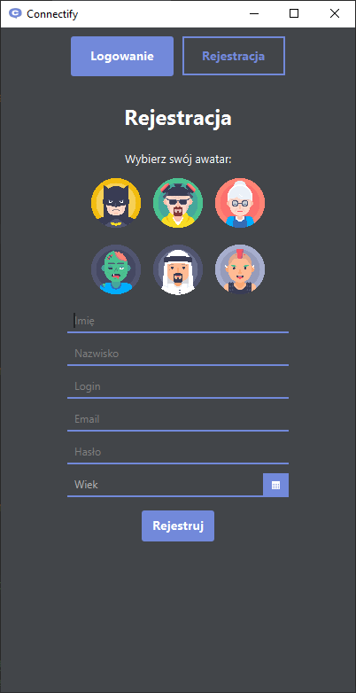
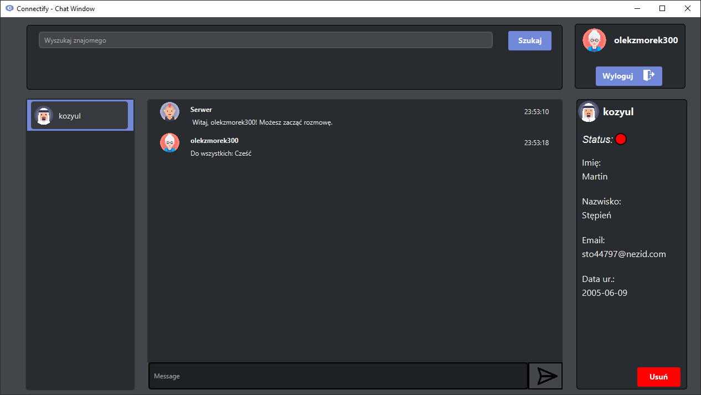
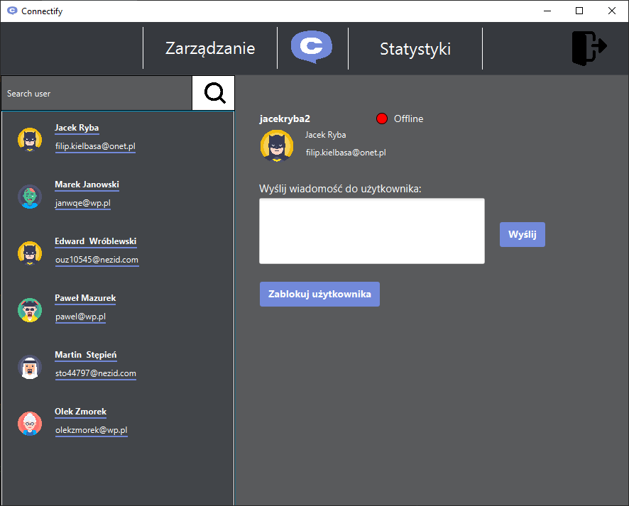
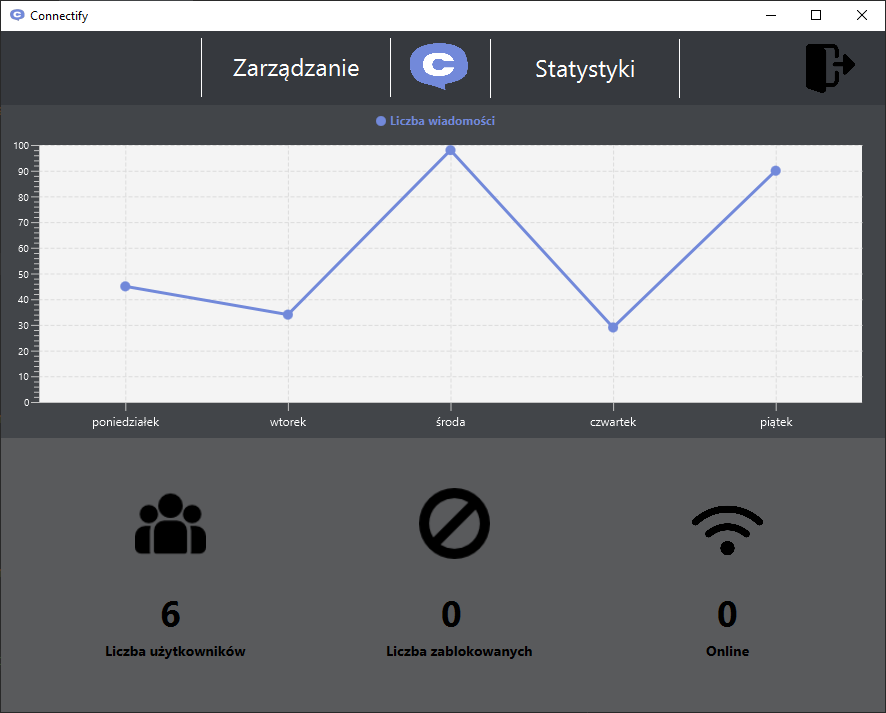

<p align="center">
  
</p>

<h1 align="center">Connectify</h1>

<p align="center">
  A desktop chat application with a friends list, private messaging, an administrator panel and user statistics.
</p>

<p align="center">
  
  
  
  
  
</p>

> **Project status:** completed. Connectify was created as a team project for a Java course at university and is published as a portfolio piece. It is no longer actively developed.

---

## About the project

Connectify is a client–server desktop application. A JavaFX client lets users register, manage a friends list and chat in real time, while a multithreaded socket server relays public and private messages. Account data is stored in PostgreSQL. Administrators get a separate panel for moderating accounts and viewing platform statistics.

## Features

**Accounts and security**
- Registration with validation: unique login and e-mail, password strength rules and avatar selection
- Passwords stored encrypted in the database (AES-256 via Jasypt)
- Password recovery by e-mail (JavaMail over SMTP)
- Blocked accounts cannot log in

**Chat and friends**
- Public chat room and private messages (`/msg <login> <message>`)
- Friends list with search – add and remove friends
- Friend details with online/offline status
- Avatars and timestamps on every message

**Administration and statistics**
- Separate admin panel available after logging in with administrator credentials
- User management: browse accounts, send a message to a user, block and unblock accounts
- Statistics view: total, online and blocked users

## Screenshots

| Registration | Chat |
| :---: | :---: |
|  |  |

| Administrator panel | Statistics |
| :---: | :---: |
|  |  |

> The application interface is in Polish.

## Architecture

```
┌────────────────┐   TCP :12345   ┌─────────────────┐
│  JavaFX client │ ◄────────────► │   Chat server   │
│  (UI + logic)  │                │  (ServerClient) │
└───────┬────────┘                └─────────────────┘
        │ JDBC
        ▼
┌────────────────┐
│   PostgreSQL   │   users, friends, status
└────────────────┘
```

- **Chat server** (`ServerClient.Server`) listens on port `12345`, handles every client in a separate thread and broadcasts public and private messages.
- **Client** (`org.example.App`) is a JavaFX application. It reads and writes account and friend data in PostgreSQL over JDBC and connects to the chat server through a TCP socket.

```
connectify-project-app/
├── Connectify/
│   ├── pom.xml
│   ├── javadoc/                    # generated API documentation
│   └── src/main/
│       ├── java/
│       │   ├── org/example/        # view controllers, App (entry point)
│       │   │   ├── connection/     # database access (Connect)
│       │   │   ├── client/         # chat client logic
│       │   │   └── mail/           # e-mail sending (MailSender)
│       │   ├── ServerClient/       # chat server and client
│       │   ├── Admin/              # admin panel user list model and controller
│       │   └── Message/            # single message model and controller
│       └── resources/org/example/  # FXML views, CSS styles, images
└── imgs/                           # screenshots used in this README
```

## Tech stack

| Layer | Technologies |
| --- | --- |
| Language | Java 11 |
| User interface | JavaFX 13 (FXML + CSS) |
| Networking | TCP sockets (`java.net.Socket`, `ServerSocket`) |
| Database | PostgreSQL (JDBC driver 42.6.1) |
| E-mail | JavaMail 1.6.2 |
| Encryption | Jasypt 1.9.3 |
| Build | Maven, Java Platform Module System |
| Documentation | Javadoc |

## Getting started

Requirements: JDK 11+, Maven 3.6+ and a PostgreSQL database containing the `public.connectify` table. An SMTP account is needed only for password recovery.

### Configuration

Sensitive settings are read from environment variables:

| Variable | Description |
| --- | --- |
| `HOST` | PostgreSQL host |
| `PORT` | PostgreSQL port |
| `DBNAME` | database name (also used as the database user name) |
| `PASS` | database password (also used as the key that encrypts user passwords) |
| `EMAIL` | sender address for password recovery e-mails |
| `EMAIL_PASSWORD` | password of the SMTP account |
| `ALOGIN` | administrator login |
| `APASSWORD` | administrator password |

Example (PowerShell):

```powershell
$env:HOST = "localhost"
$env:PORT = "5432"
$env:DBNAME = "connectify"
$env:PASS = "<database password>"
$env:EMAIL = "<sender e-mail>"
$env:EMAIL_PASSWORD = "<e-mail password>"
$env:ALOGIN = "<admin login>"
$env:APASSWORD = "<admin password>"
```

### Run

1. Clone the repository:
```bash
git clone https://github.com/enqer/connectify-project-app.git
cd connectify-project-app/Connectify
```

2. Start the chat server by running the `ServerClient.Server` class (for example from your IDE).

3. Start the client. You can launch several instances to try out conversations:
```bash
mvn clean javafx:run
```

## Documentation

The Javadoc API documentation is located in [`Connectify/javadoc`](Connectify/javadoc/index.html). Open `index.html` in a browser after cloning the repository.

## Known limitations

Connectify is an educational project. Before any production use it would need, among other things:

- parameterised queries (`PreparedStatement`) instead of SQL built from strings,
- password hashing (bcrypt or Argon2) instead of reversible encryption,
- client authentication in the chat protocol,
- real data behind the weekly chart in the statistics view (it currently shows sample values),
- a configurable chat server address (`localhost:12345`) and SMTP server.

## Authors

- [@enqer](https://github.com/enqer)
- [@Narothe](https://github.com/Narothe)
- [@fkielbasa](https://github.com/fkielbasa)
